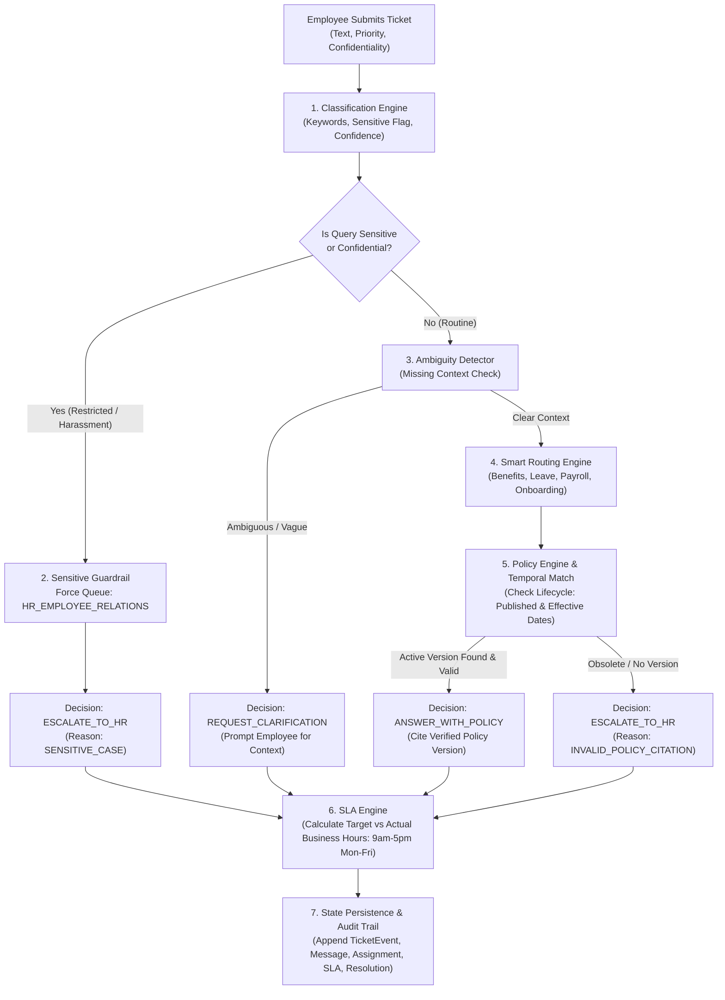
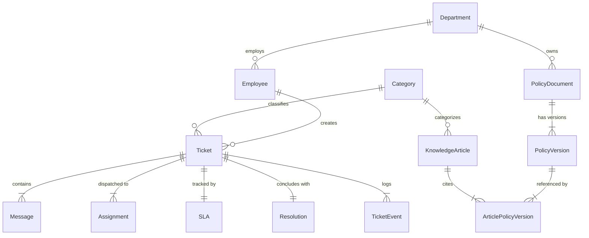
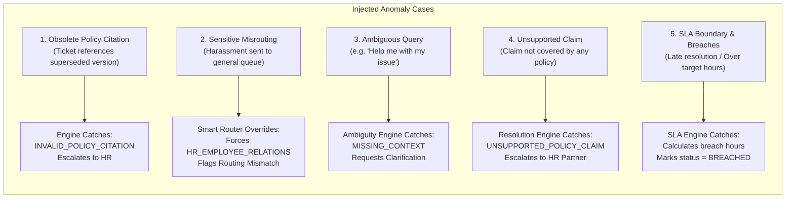

# 🏢 HR Routine Requests Resolver

[](https://www.python.org/)
[](tests/)
[](reports/validation/integrity_report.json)
[-blueviolet.svg)](reports/validation/reproducibility_report.json)
[](data/)
[](frontend/)

> **Business Context & Problem Statement:**  
> **Resolve routine HR requests using versioned policy sources, route sensitive cases, and track service SLAs.**

---

## 📑 Table of Contents
1. [Executive Summary & Problem Statement](#-executive-summary--problem-statement)
2. [Objective and Scope](#-objective-and-scope)
3. [Primary Actors and Systems](#-primary-actors-and-systems)
4. [End-to-End Workflow & Business Rules](#-end-to-end-workflow--business-rules)
5. [Architecture & System Design](#-architecture--system-design)
6. [Data Model & Data Dictionary](#-data-model--data-dictionary)
7. [Nomenclature & Identifier Conventions](#-nomenclature--identifier-conventions)
8. [Synthetic Data Generation Methodology (Steps 1–10)](#-synthetic-data-generation-methodology-steps-110)
9. [Injected Negative Scenarios & Edge Cases](#-injected-negative-scenarios--edge-cases)
10. [Measurable Evaluation Metrics & Acceptance Criteria](#-measurable-evaluation-metrics--acceptance-criteria)
11. [Interactive Frontend Web App & Studio](#-interactive-frontend-web-app--studio)
12. [Repository Layout](#-repository-layout)
13. [Installation & Quick Start Guide](#-installation--quick-start-guide)
14. [Public Data Guidance & Lawful Provenance](#-public-data-guidance--lawful-provenance)

---

## 📌 Executive Summary & Problem Statement

Human Resources service desks handle thousands of routine and sensitive inquiries daily. In enterprise organizations, operational challenges frequently arise:
- **Policy Drift & Obsolete Citations:** Policies undergo continuous revision. Providing answers based on superseded policy versions introduces legal, contractual, and compliance liability.
- **Sensitive Inquiry Misrouting:** Workplace harassment, discrimination, and misconduct inquiries accidentally sent to general support queues breach employee confidentiality and privacy regulations.
- **Ambiguity & Missing Context:** Incomplete inquiries (e.g., *"Help me with my issue"*) drain specialist hours through back-and-forth communication.
- **SLA Calculation Discrepancies:** Standard calendar-day calculations fail to account for enterprise business hours (9:00 AM – 5:00 PM, Monday to Friday), causing distorted SLA breach metrics.

**HR Routine Requests Resolver** is an enterprise-grade, rule-and-policy-driven solution that automates routine inquiry classification, enforces strict isolation for sensitive complaints, validates versioned policy citations against temporal effective dates, tracks business-hour SLAs, and maintains comprehensive event-level traceability.

---

## 🎯 Objective and Scope

The objective is to implement a robust, fully traceable end-to-end workflow demonstrating:
1. **Multi-Entity Relational Data Model:** 11 core entities, 1 bridge table, strict foreign keys, and zero orphaned records.
2. **Deterministic Multi-Stage Business Logic:**
   - Real-time inquiry classification across Benefits, Leave, Payroll, Onboarding, and Employee Relations.
   - Active policy version validation against request dates and audience criteria (`Employee`, `Manager`, `Candidate`).
   - Strict routing safeguards for confidential/restricted inquiries.
   - Business-hour SLA calculations with priority windows (Critical: 8h, High: 24h, Medium: 40h, Low: 80h).
3. **Traceability & Auditing:** Explicit event and message history preserving state transitions without destructive overwrites.
4. **Separate Ground Truth Decoupling:** Anomalies, expected decisions, and error labels stored independently without leaking into feature inputs.
5. **Interactive Operations Studio:** A browser-based executive dashboard and live resolution simulator.

---

## 👥 Primary Actors and Systems

| Actor / System | Role & Responsibilities |
| :--- | :--- |
| **Employee / Candidate** | Submits routine inquiries (benefits, leave, payroll, joining documents) or sensitive grievances. |
| **Manager** | Reviews audience-restricted managerial policies, approves team leave requests, and receives escalated managerial inquiries. |
| **HR Partner (Specialist)** | Handles escalated inquiries, employee relations grievances, confidential complaints, and policy exceptions. |
| **IT / Operations Partner** | Configures queue routing dispatch, monitors message event streams, and manages SLA compliance. |
| **System Administrator** | Audits policy lifecycle versions, validates data integrity, inspects reproducibility checksums, and reviews ground truth. |

---

## 🔄 End-to-End Workflow & Business Rules



### Core Business Rules
1. **Master Data First:** Master tables (`Department`, `Employee`, `Category`, `PolicyDocument`, `PolicyVersion`, `KnowledgeArticle`) are generated prior to any dependent transaction records.
2. **Strict Sensitive Isolation:** Any inquiry containing restricted confidentiality or sensitive keywords (`harassment`, `discrimination`, `retaliation`, `misconduct`) **must never enter a general queue**. It is locked to `HR_EMPLOYEE_RELATIONS` with priority dispatch.
3. **Temporal Policy Validity:** Answers may only cite policy versions where:
   $$\text{effective\_from} \le \text{as\_of\_date} < \text{effective\_to} \quad \text{and} \quad \text{status} = \text{'Active'}$$
   Citing a superseded version triggers an immediate exception (`INVALID_POLICY_CITATION`) and escalates to a human partner.
4. **Audience Filtering:** Policies restricted to `Manager` or `Candidate` cannot be cited for general `Employee` inquiries.
5. **Business-Hour SLA Engine:** SLA timers increment exclusively during business hours (09:00 to 17:00, Monday through Friday). Weekends and after-hours periods are excluded from actual elapsed turnaround time.
6. **Immutable State Transitions:** Every status change, assignment reroute, or message exchange generates an explicit child event record; historical records are never overwritten.

---

## 🏛 Architecture & System Design

```
HR_Routine_Requests_Resolver/
├── src/
│   ├── engine/                # Core Domain Engines
│   │   ├── classification.py  # Rule-based NLP classifier & ambiguity detector
│   │   ├── routing_engine.py  # Queue router & sensitivity isolation
│   │   ├── policy_engine.py   # Version retrieval & temporal citation validator
│   │   ├── resolution_engine.py# Decision arbitrator (Answer, Escalate, Clarify)
│   │   ├── sla_engine.py      # Business-hour interval calculator & breach tracker
│   │   └── lifecycle_engine.py# Ticket state machine transitions
│   ├── generators/            # Deterministic Synthetic Generators (Seed: 20261022)
│   │   ├── master_generator.py# Employees, Departments, Policies, Versions, Articles
│   │   ├── ticket_generator.py# 5,000 Tickets across routine & negative categories
│   │   ├── message_generator.py# 20,000 Chronological conversation messages
│   │   └── event_generator.py # Audit events, assignments, SLAs, resolutions
│   ├── integration/
│   │   └── workflow.py        # End-to-end pipeline runner & decision reconciler
│   └── validation/            # Verification & Compliance Guardrails
│       ├── integrity.py       # Primary/Foreign key validator (27 checks)
│       ├── business_rules.py  # Anomaly & policy compliance auditing
│       ├── reproducibility.py # Dual-run checksum verifier
│       └── report.py          # Unified reporting orchestrator
├── data/                      # Data Artifacts
│   ├── master/                # Master CSVs (employees, policies, departments, etc.)
│   ├── transactions/          # Transaction CSVs (tickets, messages, SLAs, events)
│   └── ground_truth/          # Isolated Ground Truth labels (anomaly audit)
├── sql/                       # Relational Schema & Analytical Queries
│   ├── schema.sql             # DDL with constraints, foreign keys, and indices
│   ├── relationships.sql      # Formal cardinality & relational integrity rules
│   └── analytics.sql          # SQL auditing queries
├── reports/                   # Audit Outputs & Decision Logs
│   ├── integration/           # ticket_decisions.csv (5,000 audited rows)
│   └── validation/            # validation_summary.json, integrity_report.json
├── frontend/                  # Web App & Operations Studio
│   ├── index.html             # Executive Dashboard & Live Resolver Studio
│   ├── app.js                 # Reactive state, Chart.js integrations & API client
│   └── styles.css             # Responsive styling & design system
├── tests/                     # Automated Test Suite (58 tests, 100% passing)
├── serve.py                   # High-performance Python backend HTTP API
├── requirements.txt           # Minimal dependencies (pandas, numpy, pytest, pytest-cov)
└── README.md                  # Comprehensive documentation
```

---

## 📊 Data Model & Data Dictionary

### Entity-Relationship Diagram (ERD)



### Data Dictionary

| Entity | Primary Key | Foreign Keys | Cardinality | Key Fields & Allowed Enums | Validation Rule |
| :--- | :--- | :--- | :--- | :--- | :--- |
| **`Department`** | `department_id` | *None* | `1:N` with Employee, PolicyDocument | `department_name` (Unique) | Must be non-empty and unique. |
| **`Employee`** | `employee_id` | `department_id` &rarr; Department | `N:1` with Department, `1:N` with Ticket | `employment_type` (`Full-time`, `Part-time`, `Contract`), `employment_status` (`Active`, `Inactive`), `audience` (`Employee`, `Manager`, `Candidate`), `location` | `department_id` must reference valid Department. |
| **`PolicyDocument`**| `policy_id` | `department_id` &rarr; Department | `1:N` with PolicyVersion | `policy_title`, `audience` (`Employee`, `Manager`, `Candidate`, `All`), `lifecycle_state` (`Published`, `Draft`, `Archived`) | Must have at least 1 active version when Published. |
| **`PolicyVersion`** | `version_id` | `policy_id` &rarr; PolicyDocument | `N:1` with PolicyDocument, `M:N` with KnowledgeArticle | `version_number` (Int), `effective_from` (Date), `effective_to` (Date or null), `status` (`Active`, `Superseded`), `policy_text` | `effective_to` > `effective_from` or null. Unique(`policy_id`, `version_number`). |
| **`Category`** | `category_id` | *None* | `1:N` with KnowledgeArticle, Ticket | `category_name` (`benefits`, `leave`, `payroll`, `onboarding`, `employee_relations`, etc.) | Unique category names. |
| **`KnowledgeArticle`**| `article_id` | `category_id` &rarr; Category | `1:N` with Bridge, `1:N` with Resolution | `title`, `answer_snippet`, `status` (`Published`, `Draft`) | Non-empty snippet with valid policy references. |
| **`ArticlePolicyVersion`**| `link_id` | `article_id` &rarr; KnowledgeArticle, `version_id` &rarr; PolicyVersion | `M:N` Bridge | `link_id`, `article_id`, `version_id` | Composite uniqueness: Unique(`article_id`, `version_id`). |
| **`Ticket`** | `ticket_id` | `employee_id` &rarr; Employee, `category_id` &rarr; Category | `1:N` with Message, Assignment, Event; `1:1` with SLA, Resolution | `description`, `priority` (`Critical`, `High`, `Medium`, `Low`), `confidentiality` (`Internal`, `Confidential`, `Restricted`), `status` (`Open`, `In_Progress`, `Resolved`, `Escalated`) | Created timestamp must be strictly ordered. |
| **`Message`** | `message_id` | `ticket_id` &rarr; Ticket | `N:1` with Ticket | `sender_type` (`Employee`, `HR`, `System`), `message_type` (`Request`, `Clarification`, `Response`, `Resolution`), `message_text`, `created_at` | `created_at` &ge; Ticket `created_at`. |
| **`Assignment`** | `assignment_id`| `ticket_id` &rarr; Ticket | `N:1` with Ticket | `queue` (`HR_BENEFITS`, `HR_LEAVE`, `HR_PAYROLL`, `HR_ONBOARDING`, `HR_EMPLOYEE_RELATIONS`, `HR_GENERAL`), `is_current` (Boolean), `assigned_at` | Exactly one `is_current = True` record per ticket at any time. |
| **`SLA`** | `sla_id` | `ticket_id` &rarr; Ticket | `1:1` with Ticket | `target_hours` (8.0, 24.0, 40.0, 80.0), `actual_hours` (Real), `sla_status` (`MET`, `BREACHED`) | Computed from business hours between created and resolved timestamps. |
| **`Resolution`** | `resolution_id`| `ticket_id` &rarr; Ticket, `article_id` &rarr; KnowledgeArticle | `1:1` with Ticket | `outcome` (`Resolved`, `Escalated`, `Clarified`), `resolved_at` | `resolved_at` &ge; Ticket `created_at`. |
| **`TicketEvent`** | `event_id` | `ticket_id` &rarr; Ticket | `N:1` with Ticket | `event_type` (`CREATED`, `CLASSIFIED`, `ROUTED`, `CLARIFICATION_REQUESTED`, `ESCALATED`, `RESOLVED`), `event_timestamp` | Immutable chronological event log. |

---

## 🏷 Nomenclature & Identifier Conventions

All identifiers across files and databases use deterministic, zero-padded, immutable formats:

| Entity | Format Pattern | Example |
| :--- | :--- | :--- |
| **Ticket** | `TKT-YYYY-NNNNNN` | `TKT-2026-000001` |
| **Policy Document** | `POL-HR-YYYY-NNN` | `POL-HR-2026-001` |
| **Policy Version** | `VER-<policy-id>-NN` | `VER-POL-HR-2026-001-03` |
| **Knowledge Article** | `KB-NNNNNN` | `KB-000001` |
| **Article Link Bridge** | `APL-NNNNNN` | `APL-000001` |
| **Message** | `MSG-<ticket-id>-NNN` | `MSG-TKT-2026-000001-001` |
| **Assignment** | `ASN-NNNNNN` | `ASN-000001` |
| **SLA Record** | `SLA-NNNNNN` | `SLA-000001` |
| **Resolution Record** | `RES-NNNNNN` | `RES-000001` |
| **Ticket Event** | `EVT-NNNNNN` | `EVT-000001` |
| **Employee** | `EMP-NNNNNN` | `EMP-000151` |
| **Department** | `DEPT-NNN` | `DEPT-003` |
| **Category** | `CAT-NNN` | `CAT-001` |

---

## ⚙️ Synthetic Data Generation Methodology (Steps 1–10)

The data generation pipeline follows a granular, 10-step protocol designed for zero-leakage, absolute reproducibility, and realistic distribution modeling:

- **Step 1: Data Dictionary Formalization**  
  Authored relational specifications defining types, mandatory constraints, allowed enums, units, and integrity constraints for all 11 core entities.
- **Step 2: Hierarchical Generation (Master First, Dependent Child After)**  
  Generated primary master entities (`Department`, `Employee`, `Category`, `PolicyDocument`, `PolicyVersion`, `KnowledgeArticle`) before instantiating tickets or transactions.
- **Step 3: Deterministic Identifier Assignment**  
  Applied strictly sequential zero-padded identifiers matching standard nomenclature.
- **Step 4: Baseline Volume Generation**  
  Generated **5,000 tickets**, **150 policy knowledge articles**, **20,000 messages**, **30 policy documents**, **90 versions**, and **1,000 employees** using fixed seed `20261022`.
- **Step 5: Labelled Edge Case Injection**  
  Synthesized deliberate anomalies (obsolete citations, misrouted sensitive cases, SLA business-hour breaches, unsupported policy claims) with explicit ground truth labels.
- **Step 6: Algorithmic Derived Values**  
  Turnaround hours, SLA statuses, breach intervals, and routing decisions are computed through domain logic rather than random generation.
- **Step 7: Ground Truth Decoupling**  
  Isolated all anomaly tags, issue classifications, and expected decisions in [`data/transactions/ground_truth.csv`](file:///C:/Users/divya/OneDrive/Documents/Hackathon/HR_Routine_Requests_Resolver/data/transactions/ground_truth.csv). Input ticket descriptions do not leak labels.
- **Step 8: Comprehensive Validation Execution**  
  Ran automated integrity suites covering primary key uniqueness, foreign key relationships, chronological order, and status machine transitions.
- **Step 9: Artifact Export**  
  Exported normalized CSVs, SQLite relational schema DDL (`sql/schema.sql`), analytics queries (`sql/analytics.sql`), and validation logs (`reports/validation/`).
- **Step 10: Dual-Run Checksum Reproducibility**  
  Regenerated the entire dataset twice from scratch into `data_run1` and `data_run2` with seed `20261022`. Compared row counts and SHA-256 checksums across all 29 generated files (0 differences detected).

---

## 🧪 Injected Negative Scenarios & Edge Cases

To validate the engine's exception handling and guardrails, specific negative scenarios were injected and labeled:



1. **Answer Cites Obsolete Policy (`OBSOLETE_POLICY_CITATION`):**
   - *Scenario:* Resolution references a superseded policy version whose `effective_to` date has elapsed.
   - *Guardrail:* The engine intercepts the citation, refuses automated answer disclosure, and converts the outcome to `ESCALATE_TO_HR` with reason `INVALID_POLICY_CITATION`.
2. **Sensitive Case Assigned to General Queue (`SENSITIVE_CASE_WRONG_QUEUE`):**
   - *Scenario:* A ticket contains sensitive workplace harassment or retaliation keywords but is initially submitted to a general queue.
   - *Guardrail:* The routing engine detects restricted sensitivity, immediately overrides the assignment to `HR_EMPLOYEE_RELATIONS`, and records a `routing_mismatch` audit flag.
3. **Vague Inquiry with Missing Context (`MISSING_CONTEXT`):**
   - *Scenario:* Ticket contains phrases like *"Please help me"* without category or specifics.
   - *Guardrail:* Flagged as ambiguous; sets decision to `REQUEST_CLARIFICATION` and halts policy citation until clarified.
4. **Unsupported Policy Claim Presented as Fact (`UNSUPPORTED_POLICY_CLAIM`):**
   - *Scenario:* An inquiry asserts policy benefits not established in published documents.
   - *Guardrail:* Escalates directly to an HR partner for review.
5. **SLA Business Hours Calculation & Breach Detection:**
   - *Scenario:* Tickets resolved across weekends or after-hours.
   - *Guardrail:* Evaluates only 9:00 AM to 5:00 PM business hours. Exactly 370 intentional breach cases are correctly identified and logged with exact `breach_hours`.

---

## 📈 Measurable Evaluation Metrics & Acceptance Criteria

All metrics are derived from auditing the complete 5,000-ticket integration dataset in [`reports/integration/integration_metrics.json`](file:///C:/Users/divya/OneDrive/Documents/Hackathon/HR_Routine_Requests_Resolver/reports/integration/integration_metrics.json) and [`reports/validation/validation_summary.json`](file:///C:/Users/divya/OneDrive/Documents/Hackathon/HR_Routine_Requests_Resolver/reports/validation/validation_summary.json):

| Metric | Target / Standard | Observed Value | Status |
| :--- | :--- | :--- | :---: |
| **Total Processed Inquiries** | Baseline volume: 5,000 | **5,000 Tickets** | ✅ PASS |
| **Auto-Classification Rate** | Realistic NLP matching (&gt; 90%) | **94.08%** (4,704 classified) | ✅ PASS |
| **Ambiguity Detection** | Identify vague queries | **296 Tickets** (5.92%) | ✅ PASS |
| **Clarification Requests Sent** | Prompt missing context | **286 Requests** | ✅ PASS |
| **Sensitive Case Isolation (Rule #1)**| **100%** compliance to restricted queue | **100.00%** (946 / 946) | ✅ PASS |
| **Policy Answers Automated** | Cite verified active policies | **3,758 Tickets** (75.16%) | ✅ PASS |
| **Policy Citation Validity** | Zero obsolete citations published | **100.00% Validated** | ✅ PASS |
| **Smart Router Mismatch Correction**| Detect initial general queue misroutes | **21.78%** (1,089 corrected) | ✅ PASS |
| **Overall SLA Compliance Rate** | Target adherence (&gt; 90%) | **92.60%** (4,630 Met / 370 Breached)| ✅ PASS |
| **Relational Integrity Checks** | 0 orphan records, valid foreign keys | **27 / 27 Checks Passed** | ✅ PASS |
| **Seed Reproducibility** | Identical SHA-256 across runs | **100% Identical** (29 files) | ✅ PASS |
| **Unit & Integration Test Suite** | Full pass rate | **58 / 58 Tests Passed** (0.95s)| ✅ PASS |

---

## 💻 Interactive Frontend Web App & Studio

An interactive operations studio is included to explore data, test queries, and audit system decisions.

```
HR_Routine_Requests_Resolver/
└── frontend/
    ├── index.html   # Main Dashboard & Interactive Studio
    ├── app.js       # Dynamic UI State, Chart.js Visualizations & API client
    └── styles.css   # Modern Studio Theme (Tailwind-inspired, responsive)
```

### Studio Capabilities
1. **Executive KPI Dashboard:** Real-time metrics and dynamic Chart.js visualizations for inquiry categories, SLA compliance by priority, engine decisions, and queue distributions.
2. **Live Request Resolver Studio (Playground):**
   - Interactive prompt tester for arbitrary employee requests.
   - 5 instant test presets:
     - 🩺 *Medical Insurance Enrollment* &rarr; Verified Policy Auto-Answer.
     - 🛑 *Workplace Misconduct & Harassment* &rarr; Restricted isolation to `HR_EMPLOYEE_RELATIONS`.
     - ❓ *Vague Assistance Request* &rarr; Missing Context & Ambiguity Clarification.
     - 💰 *Payroll & Tax Cutoff* &rarr; Dispatch to `HR_PAYROLL`.
     - 🌴 *Annual Leave Entitlement* &rarr; Dispatch to `HR_LEAVE`.
   - Real-time step-by-step pipeline inspector (Classification, Ambiguity, Routing, Policy Citation, SLA Prediction).
3. **Audited Ticket Explorer:** Searchable, paginated data table across all 5,000 tickets with category, SLA, decision, and sensitivity filters. Includes a click-to-view detail modal with full message conversation history.
4. **Policy Knowledge Base:** Searchable catalog of 30 policies with expandable version histories, effective date ranges, and policy text.
5. **System Validation Audit:** View foreign key integrity, business rules compliance, and reproducibility statuses.

---

## 📂 Repository Layout

```
├── .pytest_cache/             # Pytest cache
├── .venv/                     # Python 3.12 virtual environment
├── config/                    # Configuration settings
├── data/                      # Generated CSV Datasets
│   ├── master/                # employees.csv, departments.csv, policy_documents.csv,
│   │                          # policy_versions.csv, knowledge_articles.csv, categories.csv
│   ├── transactions/          # tickets.csv, messages.csv, assignments.csv, sla.csv,
│   │                          # resolutions.csv, ticket_events.csv, ground_truth.csv
│   └── exports/               # Exported formats
├── reports/                   # Validation & Integration Audits
│   ├── integration/           # ticket_decisions.csv, integration_metrics.json
│   └── validation/            # validation_summary.json, integrity_report.json,
│                              # reproducibility_report.json, business_rules_report.json
├── sql/                       # Relational DDL & SQL Audits
│   ├── schema.sql             # Full DDL schema with constraints
│   ├── relationships.sql      # Formal cardinality and relationship declarations
│   └── analytics.sql          # Analytical and compliance SQL queries
├── src/                       # Application Source Code
│   ├── engine/                # Classification, Routing, Policy, SLA, Lifecycle engines
│   ├── generators/            # Master, Ticket, Message, and Event data generators
│   ├── integration/           # workflow.py pipeline execution
│   ├── utils/                 # ID formatting, date calculators, CSV exporters
│   ├── validation/            # Integrity, business rules, and report generators
│   └── main.py                # Primary CLI data generation entrypoint
├── frontend/                  # Web App & Operations Studio
│   ├── index.html             # Single-Page Dashboard & Simulator
│   ├── app.js                 # Frontend application logic & chart renderers
│   └── styles.css             # Design styles
├── tests/                     # 58 Pytest unit and integration tests
├── serve.py                   # Unified backend API server and static host
├── README_FRONTEND.md         # Dedicated frontend documentation
├── requirements.txt           # Python dependencies
└── README.md                  # Whole project documentation
```

---

## 🚀 Installation & Quick Start Guide

### Prerequisites
- Python 3.12+ installed
- Standard tools (`pip`, `git`)

### 1. Setup Environment
```powershell
# Clone or navigate to the project directory:
cd HR_Routine_Requests_Resolver

# Create and activate a virtual environment:
python -m venv .venv
.\.venv\Scripts\Activate.ps1   # On Windows
# source .venv/bin/activate    # On Linux/macOS

# Install dependencies:
pip install -r requirements.txt
```

### 2. Run the Automated Test Suite
Verify that all 58 unit tests, foreign key integrity checks, and SLA boundary rules pass:
```powershell
pytest
```
*Expected output: `58 passed in < 1.0s`.*

### 3. Generate the Synthetic Dataset (Fixed Seed `20261022`)
```powershell
python src/main.py
```
*Generates master entities, 5,000 tickets, 20,000 messages, and all dependent transaction tables in `data/`.*

### 4. Run the End-to-End Integration Pipeline
```powershell
python src/integration/workflow.py
```
*Reconciles decisions across all 5,000 tickets, computes SLA turnaround, verifies citations, and produces `reports/integration/ticket_decisions.csv`.*

### 5. Launch the Frontend Studio & API Server
```powershell
python serve.py
```
Then open your browser to:
👉 **[http://127.0.0.1:8000](http://127.0.0.1:8000)**

If this will not open then go to the folder --> C:\Users\divya\OneDrive\Documents\Hackathon\HR_Routine_Requests_Resolver\frontend\index.html

*(Note: You can also double-click [`frontend/index.html`](file:///C:/Users/divya/OneDrive/Documents/Hackathon/HR_Routine_Requests_Resolver/frontend/index.html) to open the frontend directly in client preview mode without running the server).*

---

## 🔒 Public Data Guidance & Lawful Provenance

- **100% Synthetic & Deterministic:** All employees, policy documents, tickets, and messages were algorithmically synthesized using fixed random seeds (`20261022`).
- **Zero Real PII or Confidential Data:** No real-world personal data, proprietary enterprise policies, or restricted credentials were used. Names, departments, and text snippets are synthetic templates.
- **Lawful and Redistributable:** The schema, code, datasets, and reports are safe for open-source distribution, benchmarking, and hackathon evaluation.

